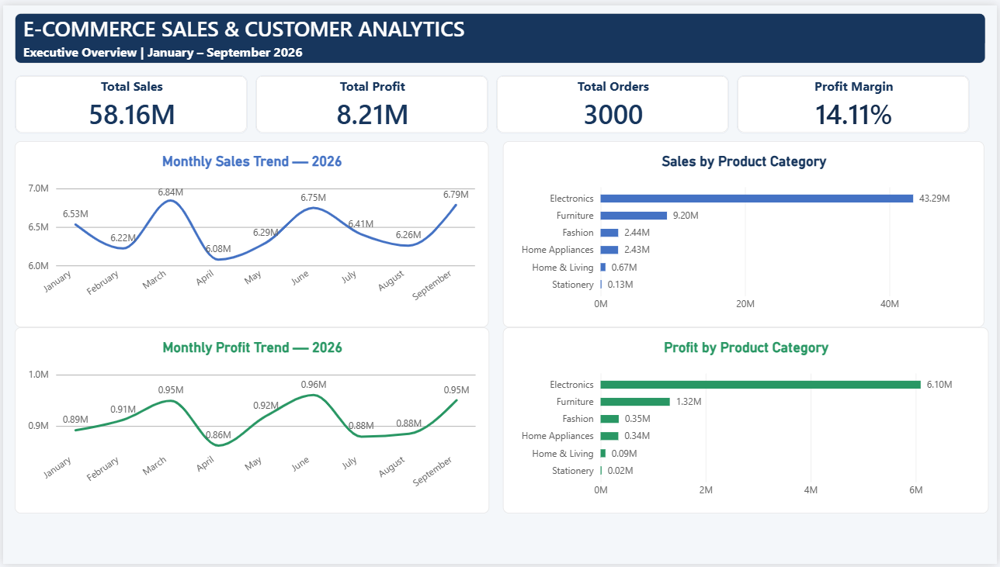
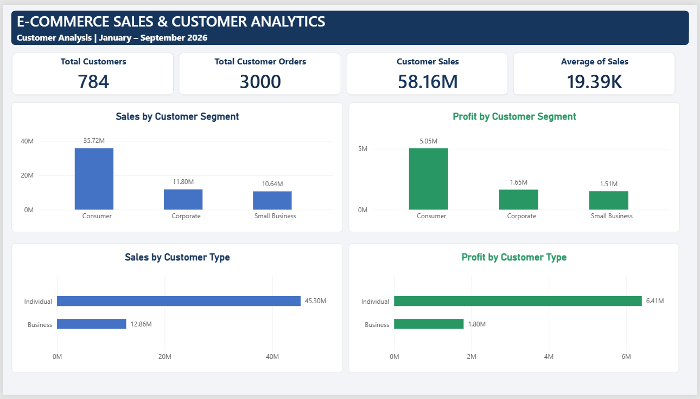
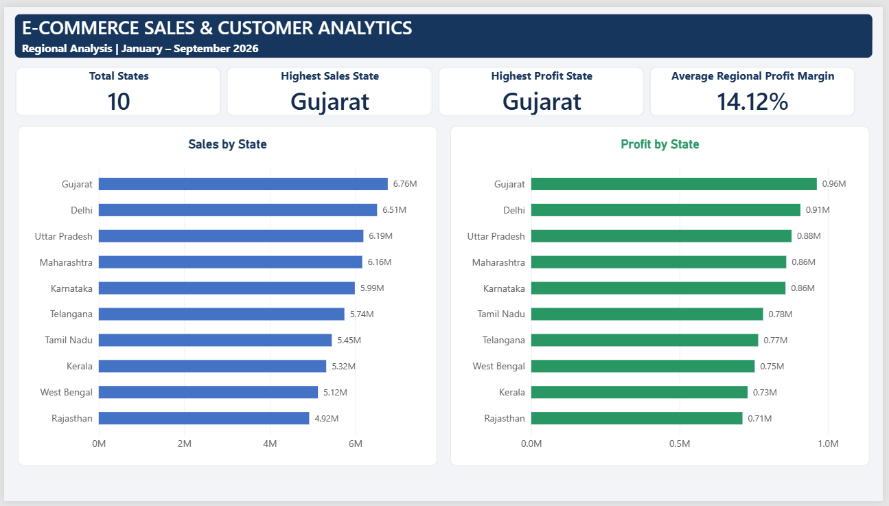
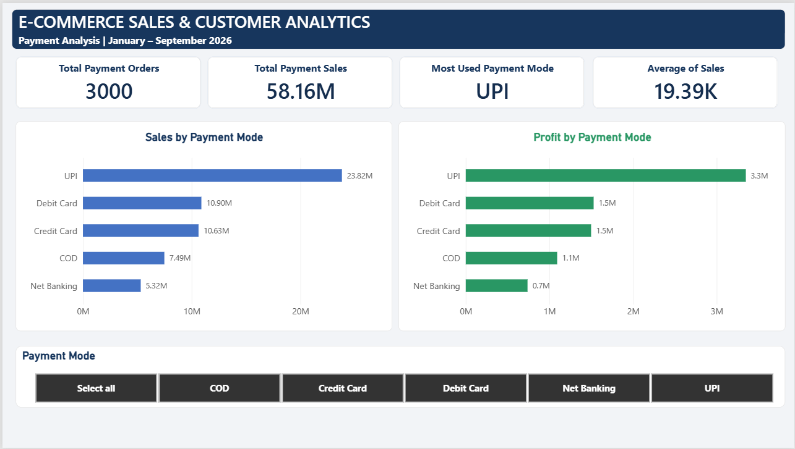
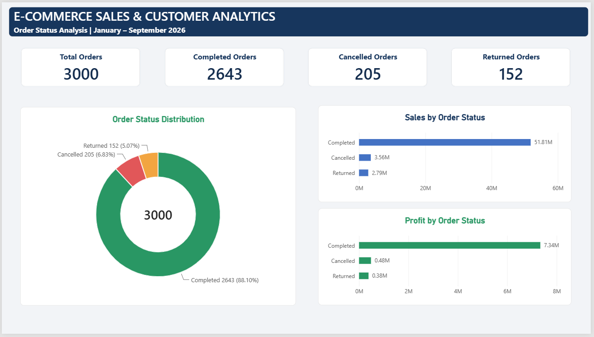
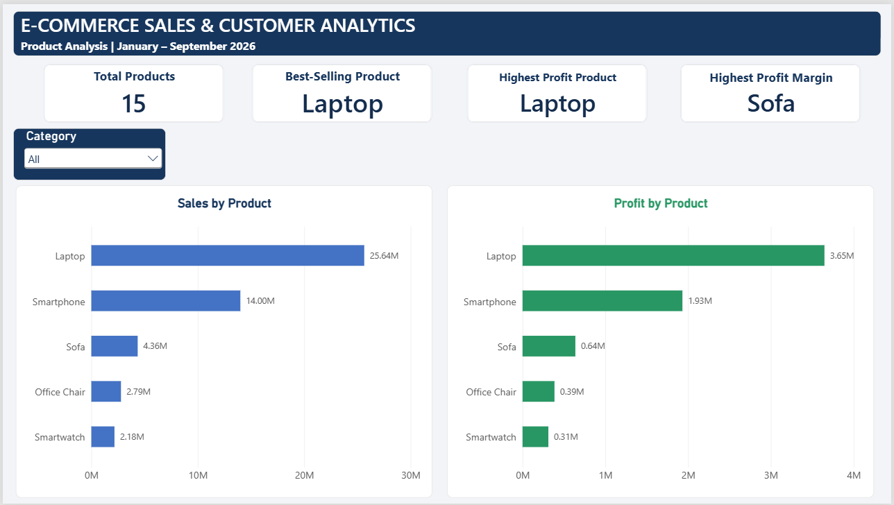

# E-Commerce Sales & Customer Analytics

An end-to-end data analytics project using Excel, Power Query, SQL, and Power BI to analyze e-commerce sales, customer behavior, product performance, and business trends.

## Project Overview

The objective of this project is to analyze e-commerce sales data and identify useful business insights. I completed data cleaning, data validation, SQL analysis, Excel reporting, and interactive Power BI dashboards.

This project helped me understand how data analysts work with business data, from raw data preparation to reporting and presenting insights.

## Project Details

| Item | Details |
|---|---|
| Project Name | E-Commerce Sales & Customer Analytics |
| Domain | E-Commerce |
| Total Records | 3,000 |
| Total Columns | 18 |
| Total Customers | 784 |
| Total Products | 15 |
| Data Period | January–September 2026 |
| Tools | Excel, Power Query, MySQL, Power BI |

## Tools & Technologies

- **Microsoft Excel:** Data analysis, Pivot Tables, formulas, and KPI calculations.
- **Power Query:** Data cleaning, transformation, standardization, and merging datasets.
- **MySQL:** Data validation, SQL queries, aggregations, and business analysis.
- **Power BI:** Interactive dashboards, KPI cards, and visual reporting.

## Project Folder Structure

```text
E-Commerce-Sales-Customer-Analytics/
│
├── 01_Raw_Data/
│   ├── ecommerce_sales_raw.xlsx
│   └── customer_master.xlsx
│
├── 02_Cleaned_Data/
│   ├── Sales_Cleaned.xlsx
│   └── ecommerce_sales_cleaned.csv
│
├── 03_Excel_Analysis/
│   └── Ecommerce_Sales_Analysis.xlsx
│
├── 04_SQL/
│   ├── 01_data_validation_and_order_status.sql
│   ├── 02_monthly_sales_profit_trends.sql
│   ├── 03_product_performance_analysis.sql
│   ├── 04_customer_segment_analysis.sql
│   ├── 05_regional_performance_analysis.sql
│   ├── 06_payment_method_analysis.sql
│   ├── 07_customer_type_analysis.sql
│   ├── 08_category_performance_analysis.sql
│   ├── 09_customer_level_analysis.sql
│   ├── 10_overall_business_kpi_summary.sql
│   ├── 11_completed_orders_performance.sql
│   └── 12_final_data_validation.sql
│
├── 05_PowerBI/
│   └── Ecommerce_Sales_Customer_Analytics.pbix
│
├── 06_Screenshots/
│   ├── 01_Executive_Overview.png
│   ├── 02_Customer_Analysis.png
│   ├── 03_Regional_Analysis.png
│   ├── 04_Payment_Analysis.png
│   ├── 05_Order_Status_Analysis.png
│   └── 06_Product_Analysis.png
│
├── 07_Documentation/
│   ├── Project_Methodology.docx
│   ├── Business_Insights_and_Recommendations.docx
│   ├── Data_Dictionary.xlsx
│   └── Data_Quality_Issues.xlsx
│
└── README.md
```

## Data Cleaning & Preparation

I used Power Query to prepare the raw sales data for analysis.

Main activities:

- Checked and corrected column names and data types.
- Removed duplicate transactions.
- Handled missing values.
- Cleaned unnecessary spaces and inconsistent text.
- Standardized state names.
- Merged the sales dataset with the Customer Master dataset using Customer ID.
- Filled missing customer details using the matching customer reference data.
- Created additional date-related columns such as Year, Month, and Quarter.
- Validated the cleaned dataset before analysis.

The final cleaned sales dataset contains 3,000 records and 18 columns.

## Key Business KPIs

| KPI | Result |
|---|---:|
| Total Sales | ₹58,159,801.49 |
| Total Profit | ₹8,207,879.29 |
| Profit Margin | 14.11% |
| Total Orders | 3,000 |
| Total Customers | 784 |
| Total Quantity Sold | 5,157 |
| Average Order Value | ₹19,386.60 |
| Returned Orders | 152 |
| Return Rate | 5.07% |
| Cancellation Rate | 6.83% |
| Completion Rate | 88.10% |

## Key Business Insights

- Electronics generated the highest sales and profit among product categories.
- Laptop was the best-performing product in terms of sales and profit.
- Gujarat recorded the highest sales among the states.
- March recorded the highest monthly sales.
- June recorded the highest monthly profit.
- UPI was the most frequently used payment method, accounting for approximately 40.20% of orders.
- Consumer customers contributed the highest total sales.
- Small Business customers had the highest average order value among customer segments.

## Power BI Dashboard

I created six interactive dashboard pages to understand different areas of the business.

### 1. Executive Overview



### 2. Customer Analysis



### 3. Regional Analysis



### 4. Payment Analysis



### 5. Order Status Analysis



### 6. Product Analysis



## Business Recommendations

- Focus on high-performing products such as laptops to maintain sales performance.
- Review the reasons behind product returns and cancellations.
- Study the sales performance of lower-performing states to identify growth opportunities.
- Monitor payment method preferences and customer purchasing behavior.
- Develop suitable strategies for different customer segments.

## Project Limitations

- The dataset contains practice data created for learning and portfolio purposes.
- The available data covers January to September 2026 only.
- Recorded profit figures are based on the dataset and should not automatically be treated as audited net profit.

## What I Learned

Through this project, I gained practical experience in:

- Cleaning and transforming data using Power Query.
- Working with Excel formulas and Pivot Tables.
- Writing SQL queries for business analysis.
- Validating data and checking data quality.
- Building interactive dashboards using Power BI.
- Identifying business trends and communicating insights.

## Project Status

- Excel data cleaning and analysis: Completed
- SQL analysis and validation: Completed
- Power BI dashboard: Completed (6 pages)
- Project documentation: Completed
- GitHub repository organization: Completed

## Author

**Navneet Kamtam**

GitHub: [NavneetKamtam](https://github.com/NavneetKamtam)
